# Xinghuo HMI Wi-Fi Integration

**Firmware upgrade/downgrade reference for Xinghuo T1 and T5 HMIs used with industrial sewing machines.** The goal is to enable the controller's Wi-Fi network list, join a factory network, and investigate communication with **XinghuoLANServer**.

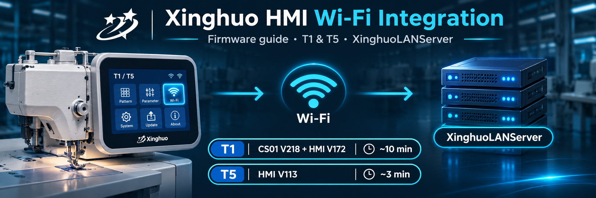

> [!IMPORTANT]
> This is an independent field guide, not an official Xinghuo or JUKI service manual. Firmware must match the exact controller hardware and OEM configuration. Back up machine parameters and sewing patterns before upgrading or downgrading, use a stable power supply, and obtain an approved recovery procedure. The timings below are field estimates, not guarantees.

## Overview

There are **two HMI types: T1 and T5**. Their Wi-Fi enablement paths differ:

| | **T1 HMI** | **T5 HMI** |
| --- | --- | --- |
| Mainboard firmware update | **Required first** | Not required for the reported workflow |
| Mainboard firmware file | `TZD_CS01_V218.TFL` | — |
| HMI/interface firmware update | **Required second** | **Required** |
| HMI/interface firmware file | `XH_HMI_T1_V172.fcav` | `XH_HMI_T5_V113.xha` |
| Estimated total update time | **~10 minutes** | **~3 minutes** |
| Expected outcome | Wi-Fi scanning works and SSID list is shown | Wi-Fi SSID list is shown |

**Important distinction:** Seeing available Wi-Fi networks is **not** proof that the HMI has joined a network, obtained an IP address, or connected to XinghuoLANServer. Those are separate validation steps.

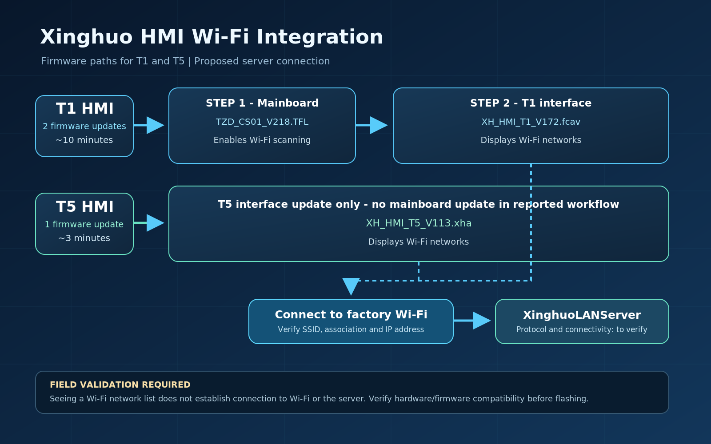

## Firmware downloads

Obtain firmware from the official **[Xinghuo CNC Technology & Download Center](https://www.xhcnc.cn/technology.html)**, under the mainboard and human-machine-interface program categories. Confirm the downloaded file's **exact name, extension, hardware revision, and OEM compatibility** before use; the latest file listed is not necessarily appropriate for your machine.

| Target | Firmware filename | Purpose |
| --- | --- | --- |
| T1 / CS01 mainboard | `TZD_CS01_V218.TFL` | Enables the mainboard-side Wi-Fi search functionality in the reported setup |
| T1 interface | `XH_HMI_T1_V172.fcav` | Makes the Wi-Fi network list accessible on the T1 HMI |
| T5 interface | `XH_HMI_T5_V113.xha` | Makes the Wi-Fi network list accessible on the T5 HMI |

These exact filenames are based on the project's field procedure. **This repository does not include third-party firmware binaries.** A filename alone does not establish compatibility.

## Prerequisites and safety

Before changing any firmware:

1. Identify and photograph the **machine model**, **mainboard model/revision**, **HMI type (T1 or T5)**, and their currently installed firmware versions.
2. Confirm the selected package is approved for the installed hardware and OEM configuration; **never flash T1 firmware on T5 or vice versa**.
3. Export or back up machine settings, sewing patterns/templates, and other configuration through the manufacturer's supported method.
4. Keep a copy of the original firmware and the manufacturer's recovery instructions. Plan downtime and maintain uninterrupted power throughout flashing.
5. Use the documented HMI menu procedure below for the **interface firmware** update. The mainboard firmware update method and firmware transfer method are not established by these screenshots; follow the manufacturer's approved procedure for those steps.
6. Keep the machine out of production until HMI communication, machine parameters, emergency stop, homing, and a controlled test cycle have all been validated by qualified personnel.

## HMI interface firmware update — photographed procedure (T5 example)

The following touchscreen sequence is documented from a **T5 HMI** on 2026-11-11. Use it when the corresponding menus are present on your machine; menu wording or workflow may differ on T1. This sequence covers the **HMI interface firmware**, **not** the T1 mainboard update.

### Step 1 — Open Menu

From the **Home** screen, tap **Menu** (bottom left).

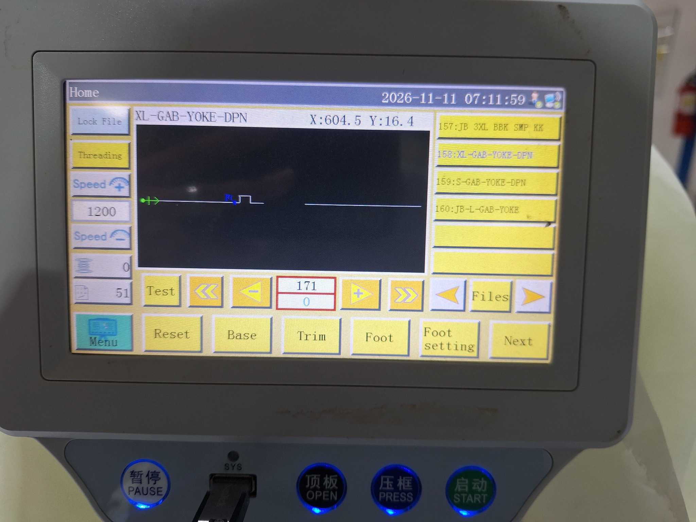

### Step 2 — Open Assist Setting

On the **Menu** screen, tap **Assist Setting**.

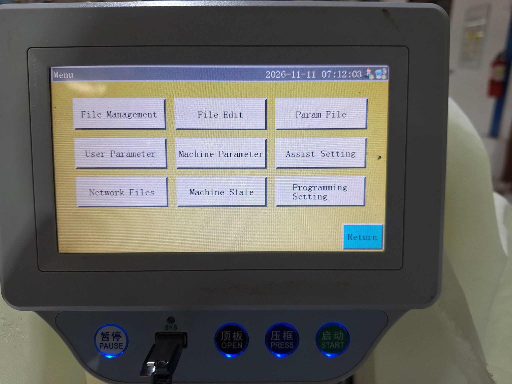

### Step 3 — Open System Upgrade

From **Assist Setting**, tap **System Upgrade**.

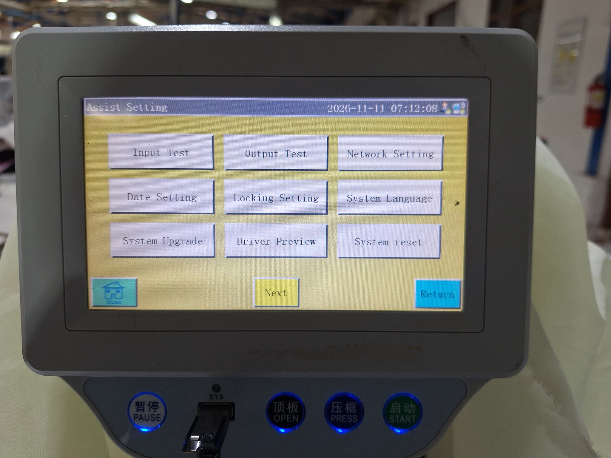

### Step 4 — Select Interface and the firmware file

On **System Upgrade**, choose **Interface** in the dropdown at the left. Locate the correct firmware file in the file list and tap the filename to select it. The example shows `XH_HMI_T5_V113.xha` on a T5 system; do not use this file for T1.

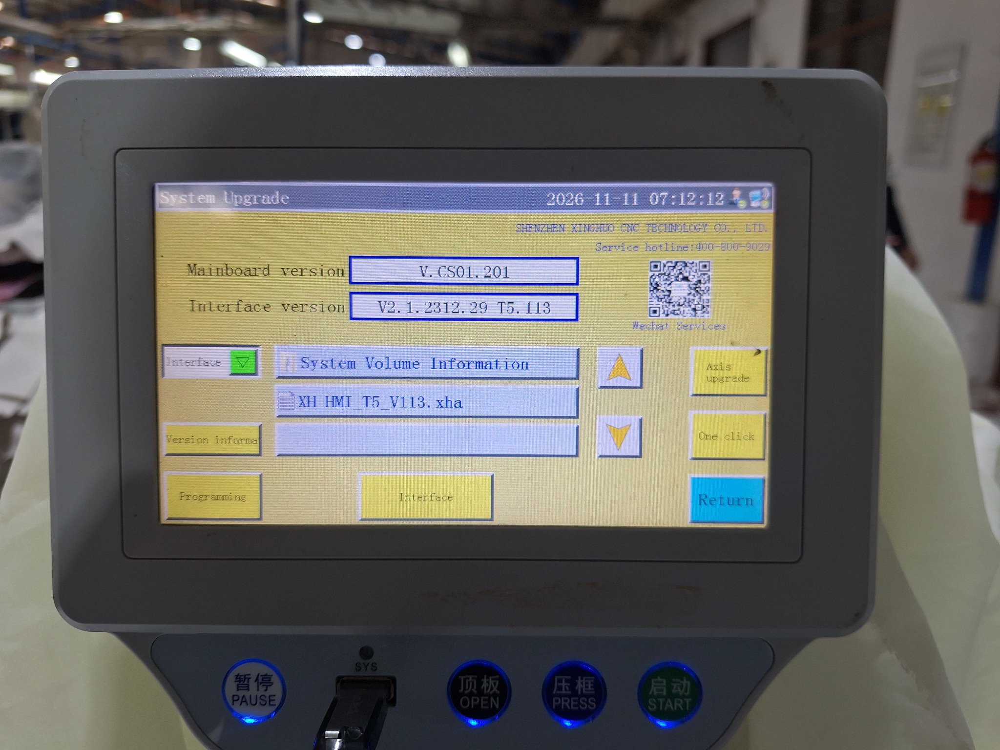

### Step 5 — Start the interface update

Confirm that the intended firmware file is highlighted, then tap the **Interface** button at the **bottom center** to start the upgrade or downgrade. Do **not** confuse this with the left-hand **Interface** dropdown, which selects the firmware category.

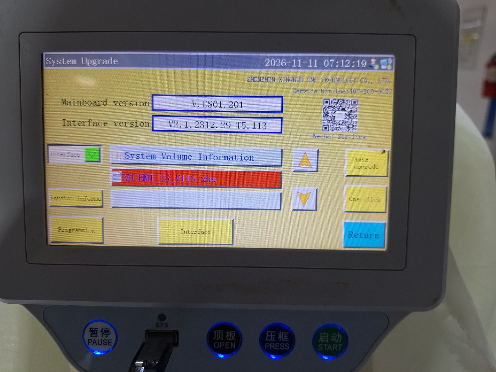

### Step 6 — Allow the update and restart

Wait for the firmware process to complete. The HMI **may restart automatically**, or a restart may be required according to the device's prompts. **Do not interrupt power during the update.** Afterward, return to **System Upgrade** to confirm the interface version and then check whether the Wi-Fi network list is available.

**Visible versions in the photographed T5 example:** mainboard `V.CS01.201` and interface `V2.1.2312.29 T5.113`. This supports the field observation that the T5 route uses an interface update without requiring the T1-specific CS01 V218 mainboard upgrade. It does **not** prove compatibility with every CS01 variant.

> [!CAUTION]
> The screenshots show the menu path and firmware selection, not a completed flashing operation or a verified server login. Confirm exact firmware compatibility, retain backups, and follow the OEM recovery procedure.

## T1 HMI — upgrade/downgrade workflow (~10 minutes)

**Required order: mainboard first, HMI interface second.**

```text
T1 HMI + compatible CS01 mainboard
              │
              ▼
1. Mainboard firmware
   TZD_CS01_V218.TFL
              │
              ▼
2. HMI / interface firmware
   XH_HMI_T1_V172.fcav
              │
              ▼
3. Restart as required by vendor procedure
              │
              ▼
4. Open Wi-Fi settings and scan for networks
              │
              ▼
5. Verify SSID list → connect → record IP
```

**Steps:**

1. Verify that the mainboard belongs to the compatible **CS01** family and record its firmware version.
2. Using the manufacturer's approved procedure, upgrade or change the **mainboard** firmware with `TZD_CS01_V218.TFL`. Allow the update and any required restart to finish.
3. Using the approved **T1 HMI** update procedure, install `XH_HMI_T1_V172.fcav`. Allow the update and any required restart to finish.
4. Open the network/Wi-Fi settings on the T1 interface and check whether the available SSIDs appear.
5. Connect to a dedicated test network and record the results in the validation table below.

**Field observation:** An earlier T1 V174 test exposed a Wi-Fi menu but could not initially find networks; a subsequent mainboard update allowed scanning. The workflow documented in this README uses the **T1 V172** file specified for the current project. Do not assume that V172/V174/V179N are interchangeable without compatibility confirmation.

## T5 HMI — upgrade/downgrade workflow (~3 minutes)

**Only the HMI interface update is needed in the reported T5 workflow.**

```text
T5 HMI
  │
  ▼
1. HMI / interface firmware
   XH_HMI_T5_V113.xha
  │
  ▼
2. Restart as required by vendor procedure
  │
  ▼
3. Open Wi-Fi settings and scan for networks
  │
  ▼
4. Verify SSID list → connect → record IP
```

**Steps:**

1. Confirm the controller has a **T5 HMI**, and record its installed firmware version.
2. Follow the [photographed HMI interface update procedure](#hmi-interface-firmware-update--photographed-procedure-t5-example) to select and install `XH_HMI_T5_V113.xha` using the bottom **Interface** button.
3. Let the update and any required restart complete; verify the resulting HMI firmware version.
4. Open Wi-Fi settings, verify that the SSID list appears, and test connection to a dedicated network.

> [!WARNING]
> “Upgrade/downgrade” describes changing to the specified tested version, which may be higher or lower than the currently installed version. It **does not** mean every earlier or later firmware is safe to install.

## Connect to factory Wi-Fi and XinghuoLANServer — photographed procedure

After completing the appropriate [T1](#t1-hmi--upgradedowngrade-workflow-10-minutes) or [T5](#t5-hmi--upgradedowngrade-workflow-3-minutes) firmware process, follow the **actual touchscreen sequence photographed on 2026-11-11**. The six photos illustrate network configuration, rather than proving that the machine successfully logged in to the server.

### Step 1 — Open Menu

From the **Home** screen, tap **Menu** at the bottom-left corner.

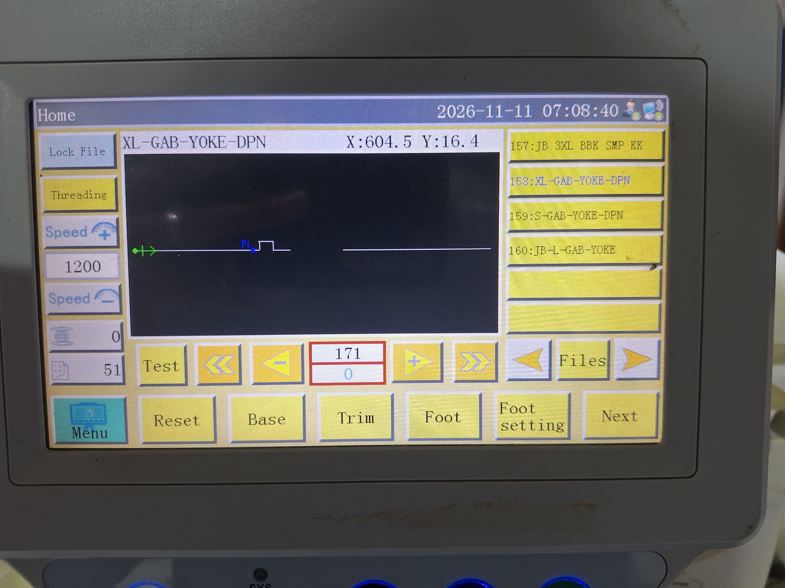

### Step 2 — Open Assist Setting

Tap **Assist Setting** from the **Menu** screen.

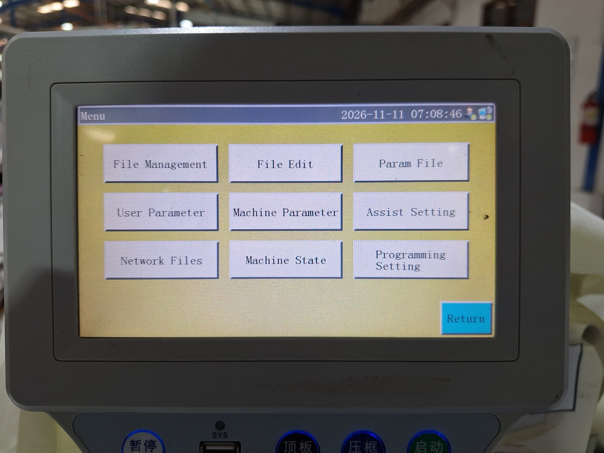

### Step 3 — Open Network Setting

On the **Assist Setting** screen, tap **Network Setting** (upper-right button).

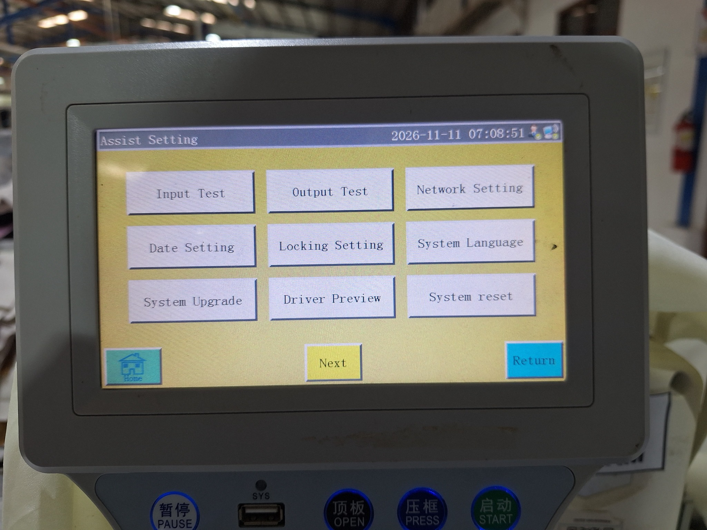

### Step 4 — Select Wireless Network, then tap WiFi

Set **Network Type** to **Wireless Network**, then tap **WiFi** (bottom row). The photographed screen also shows the **Machine address**, **Server IP**, **Server port**, **Save**, and **Login** controls; the server settings are completed in Step 7.

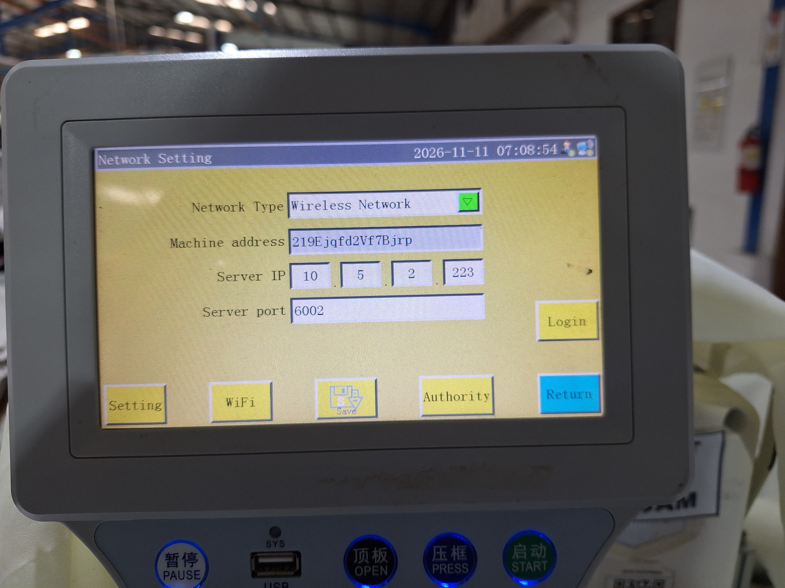

### Step 5 — Select a Wi-Fi network

The **Select Wireless Network** screen lists visible SSIDs. Tap **Refresh** if the desired network is missing, then select the factory Wi-Fi network that is allowed to reach XinghuoLANServer.

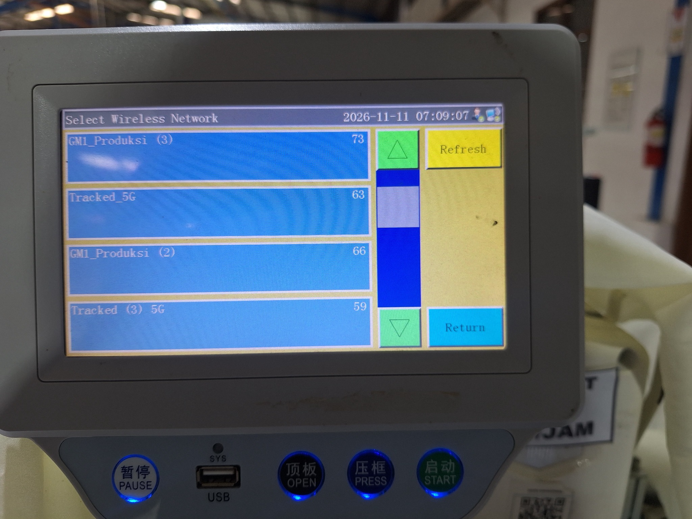

### Step 6 — Enter the wireless password and connect

In the **Please enter the wireless key** dialog, confirm the selected **SSID**, enter its password in **Key**, and tap **Connect**. After the HMI completes the connection attempt, tap **Return** to go back to **Network Setting**. Check the connection status, if available, rather than assuming that a password entry means association succeeded.

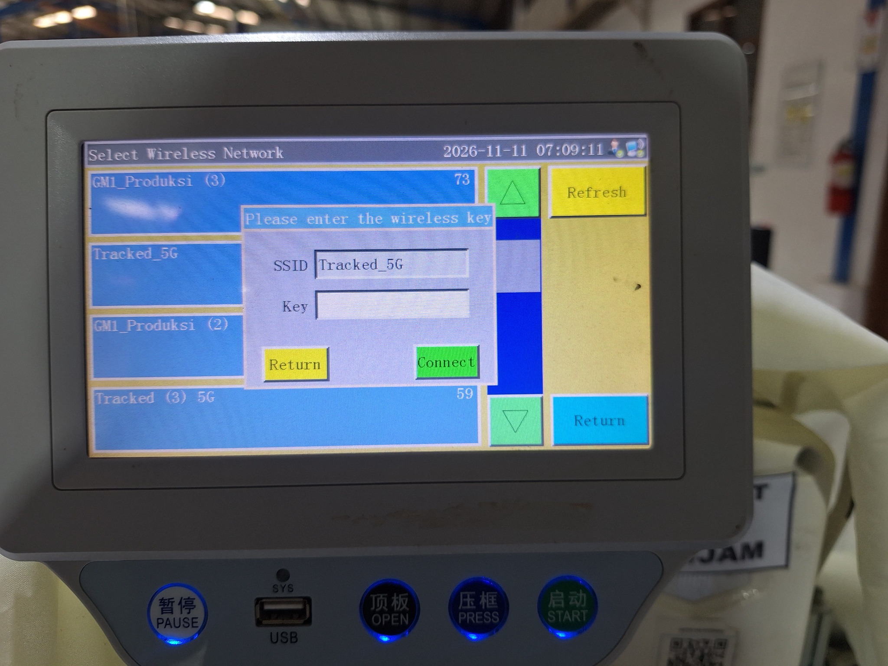

### Step 7 — Configure the XinghuoLANServer IP and port

Back on the **Network Setting** screen (shown in **Step 4**), enter the address and port for **your own reachable XinghuoLANServer**. For the photographed factory setup:

| HMI field | Photographed example | Notes |
| --- | --- | --- |
| **Network Type** | `Wireless Network` | Use the Wi-Fi connection |
| **Machine address** | Existing machine-specific value | **Do not copy another HMI's address** |
| **Server IP** | `10.5.2.223` | Example factory LAN server address |
| **Server port** | `6002` | Example factory LAN server port |
| **Save** | Button | Save updated network configuration |
| **Login** | Button | Attempt to connect/login to server |


Tap **Save**, then tap **Login**. Check the HMI for a successful connection indication and confirm the machine appears online in **XinghuoLANServer**. The HMI and server need network reachability; they do **not** have to share the exact subnet when appropriate routing and firewall rules exist.

> [!NOTE]
> `10.5.2.223:6002` is specific to the photographed installation—not a universal Xinghuo default. SSIDs shown in the photos are examples; a network name containing `5G` does not by itself establish its radio frequency. Use a compatible access point and verify the supported Wi-Fi band for the installed controller.

### Connection verification record

| Verification | Result |
| --- | --- |
| HMI and mainboard firmware versions recorded | ☐ |
| SSID appears in scanned network list | ☐ |
| HMI reports successful Wi-Fi connection | ☐ |
| IP address assigned, if viewable | ☐ |
| Network Type set to `Wireless Network` | ☐ |
| Machine address preserved | ☐ |
| Site-specific server IP and port saved | ☐ |
| Login succeeds | ☐ |
| Machine appears online in XinghuoLANServer | ☐ |
| Machine data available for monitoring | ☐ — not yet established |

### Connection flow

```text
JUKI sewing machine + Xinghuo controller
                │
        T1 or T5 HMI
                │
          Factory Wi-Fi
                │
       Factory LAN / routing
                │
                ▼
    XinghuoLANServer (example)
       10.5.2.223 : 6002
                │
      Confirm login / online status
                │
                ▼
   Optional monitoring / MES integration
            (not yet verified)
```

### Connection verification record

| Check | Result |
| --- | --- |
| HMI firmware version confirmed | ☐ |
| Wi-Fi SSID visible | ☐ |
| Wi-Fi authentication successful | ☐ |
| HMI obtained network connectivity | ☐ |
| `Network Type` set to `Wireless Network` | ☐ |
| Machine address preserved / recorded securely | ☐ |
| XinghuoLANServer IP and port saved | ☐ |
| **Login** completed successfully on HMI | ☐ |
| Machine shown online in XinghuoLANServer | ☐ |
| Production data accessible (if supported) | ☐ — not yet verified |

**Scope:** This guide documents firmware changes, Wi-Fi configuration, and the observed HMI server-settings screen. It does not establish whether XinghuoLANServer provides MQTT, HTTP, database access, or other interfaces. Any downstream factory application integration requires the official protocol or an authorized, validated connection method.

## Troubleshooting

| Symptom | Check |
| --- | --- |
| T1 Wi-Fi menu appears, but no networks | Verify that **CS01 mainboard firmware** was updated first and that HMI/mainboard versions are compatible; test near a 2.4 GHz access point. |
| T1 update fails or HMI does not communicate | Stop; verify OEM firmware compatibility, backups, and approved recovery instructions. |
| T5 Wi-Fi menu/list missing | Confirm the installed HMI is **T5** and the approved `XH_HMI_T5_V113.xha` update completed. |
| Network appears but connection fails | Check credentials, security settings, access-point compatibility, and signal. |
| Connected but no IP address | Check DHCP, isolation rules, and access-point logs. |
| Wi-Fi connected but XinghuoLANServer login fails | Check **Network Type**, server IP/port, server listener, routing, firewall and server-side machine registration; review HMI/server error messages. |
| IP works but no XinghuoLANServer connection | Confirm `Save` then `Login` were used and verify the correct site-specific server address/port. Obtain vendor protocol documentation if the problem persists. |

## Repository structure

```text
xinghuo-hmi-wifi-integration/
├── README.md
└── images/
    ├── banner.png
    ├── architecture.png
    ├── upgrade-step-1-home.jpg
    ├── upgrade-step-2-menu.jpg
    ├── upgrade-step-3-assist-setting.jpg
    ├── upgrade-step-4-system-upgrade.jpg
    ├── upgrade-step-5-select-firmware.jpg
    ├── wifi-step-1-home.jpg
    ├── wifi-step-2-menu.jpg
    ├── wifi-step-3-assist-setting.jpg
    ├── wifi-step-4-network-setting.jpg
    ├── wifi-step-5-select-network.jpg
    └── wifi-step-6-enter-password.jpg
```

No tools, scripts or proprietary firmware binaries are included.

## Licensing, attribution & disclaimer

This repository is an **independent technical guide** and is not affiliated with, approved by, or endorsed by Xinghuo CNC or JUKI. Xinghuo firmware belongs to its respective rights holder(s); obtaining files from the official download center does **not** automatically grant redistribution or modification rights. Link to the official downloads rather than rehosting the firmware unless permission is granted.

**Repository license: none specified at present.** The absence of a repository license does not grant blanket permission to reuse this guide, and no third-party firmware is licensed by this repository.

Firmware changes can alter machine behavior. Work only on authorized equipment, follow manufacturer safety instructions, and validate all safety functions before returning the machine to service.
